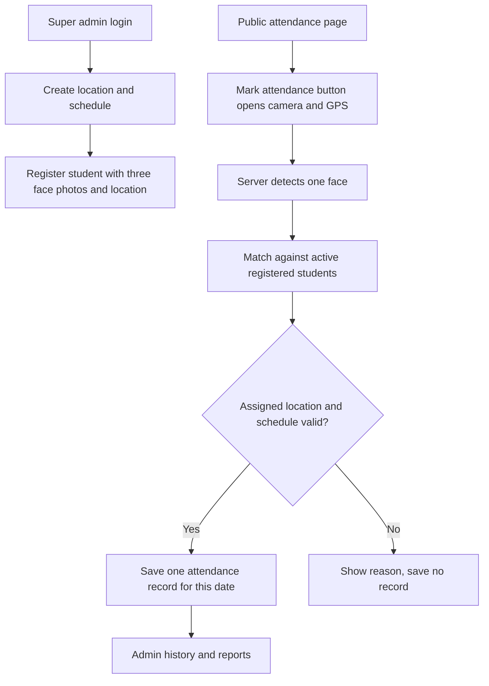

# Architecture

The Flask server stores face crops and checks identity, location and time. The database has a unique `(user_id, date)` constraint on Attendance, so concurrent attempts cannot create two records for one student and day.

The existing PostgreSQL schema has Users, FaceIdentity, Locations, Schedules, Attendance, AuditLog and ExceptionRequest tables. ExceptionRequest is retained for schema compatibility; the current public kiosk has no manager request workflow. Only active admins can authenticate. Student records use internal placeholder email and password-hash fields required by the original schema, but the student UI has no login or password field.

Face recognition uses OpenCV Haar detection and LBPH matching with a conservative threshold and ambiguity check. This is a project prototype without liveness protection.
